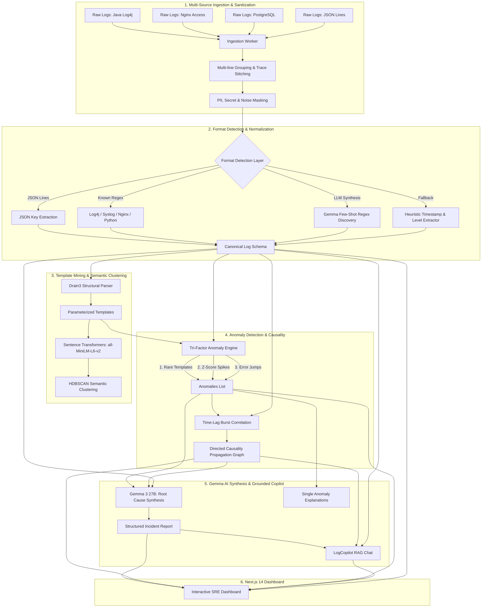
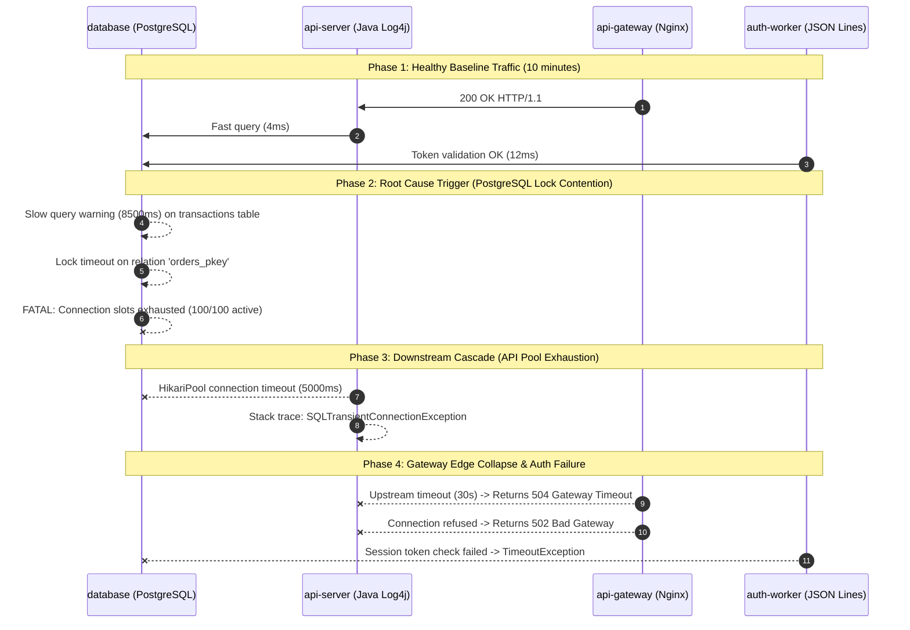

# 🔍 LogLens — AI Log Intelligence & Cascading Failure Platform

[](https://fastapi.tiangolo.com)
[](https://nextjs.org)
[](https://python.org)
[](https://www.typescriptlang.org)
[](https://ai.google.dev)
[](https://github.com/logpai/drain3)
[](https://opensource.org/licenses/MIT)

> **LogLens** is a format-agnostic, AI-driven log intelligence and incident causality analysis platform. It ingests unstructured, multi-source distributed logs in **any format**, groups multi-line traces, cleanses sensitive noise, normalizes entries into a canonical unified schema, mines parameterized templates with Drain3, clusters semantic patterns via Sentence Transformers and HDBSCAN, pinpoints multi-layered anomalies, discovers cross-service causality cascades, and leverages Google's open-weight **Gemma** LLM to deliver instant, plain-English root-cause diagnoses and interactive SRE Copilot chat.

---

## 👥 Authors & Team

LogLens was designed and built by:

- **Achraf Eddiba**
- **Ziad Boualam**
- **Hassan Ahchtar**
- **Salah Laouina**

---

## 🌟 Key Highlights & Capabilities

- **Zero-Configuration, Format-Agnostic Ingestion**: Ingests JSON/NDJSON lines, Java Log4j with multi-line stack traces, Python logging, Nginx/Apache access logs, RFC 3164/5424 Syslog, bracket-delimited logs, and unknown custom logs via LLM-assisted regex synthesis.
- **Automated PII / Noise Masking**: Redacts Bearer tokens, passwords, API keys, memory addresses (`0x[ADDR]`), UUIDs, IPs, and delimiter bursts before template parsing.
- **Unified Canonical Schema**: Projects heterogeneous logs into a single structured format (`ts`, `source`, `level`, `message`, `template_id`, `template_str`, `cluster_id`, `attrs`).
- **Drain3 Online Template Extraction**: Compresses millions of log entries into concise parameterized templates in real time.
- **Semantic Embeddings & HDBSCAN Clustering**: Computes 384-dimensional dense vectors on unique mined templates using `sentence-transformers` (`all-MiniLM-L6-v2`) and clusters semantic incident families using HDBSCAN.
- **Tri-Factor Anomaly Engine**:
  1. *Rare / New Template Detection* (infrequent or unprecedented errors).
  2. *Z-Score Spike Detection* across dynamic time-buckets (5s, 15s, 1m, 5m).
  3. *Error-Rate Jumps* detecting inter-bucket fault transitions (>20% surge).
- **Time-Lag Directed Causality Graph**: Automatically reconstructs failure cascades across services by correlating cross-service error burst sequences within sliding lag windows.
- **Gemma 3 Root-Cause Analysis**: Synthesizes the full incident sequence, affected components, and root causes with concrete remediation strategies.
- **Interactive LogCopilot (RAG Chat)**: Ask natural language questions grounded in real-time session telemetry, graph edges, and anomaly samples.
- **Built-in Cascading Failure Simulator**: One-click demo simulating PostgreSQL connection starvation cascading into API server thread pool timeouts, gateway 502/504 errors, and auth worker failures.
- **Enterprise Google OAuth 2.0**: Secure authentication flow with HttpOnly session cookies, state validation, and profile management.

---
## video of the platform 
[View the project file on Google Drive](https://drive.google.com/file/d/1U3eWaPy0no5Uc3PXtJimBQLJHWswMGE-/view?usp=sharing)
## 🏛️ System Architecture



---

## 🏗️ Unified Canonical Log Schema

Every line of incoming log data—regardless of originating vendor, framework, or transport—is parsed into the following standard data model:

```json
{
  "ts": "2026-10-24T10:15:30.123Z",
  "source": "api-server",
  "level": "ERROR",
  "message": "HikariPool-1 - Connection is not available, request timed out after 30000ms",
  "template_id": "14",
  "template_str": "HikariPool-<NUM> - Connection is not available, request timed out after <NUM>ms",
  "cluster_id": 2,
  "attrs": {
    "thread": "http-nio-8080-exec-4",
    "logger": "com.zaxxer.hikari.pool.HikariPool",
    "parser": "log4j"
  }
}
```
Raw Logs ➔ Ingestion & Multi-Line Grouping ➔ Format Discovery ➔ Normalization & PII Redaction
    ➔ Drain3 Template Mining ➔ Semantic Embeddings ➔ Onset & Anomaly Detection
    ➔ Deterministic Root Cause Scoring ➔ LLM Narration with [E#] Citations
```

1. **Format-Agnostic Ingestion & PII Redaction**:
   - Multi-line stack traces are stitched into single canonical log events.
   - Credentials, passwords, bearer tokens, and emails are masked.
2. **Deterministic Onset Detection**:
   - Evaluates baseline error rates (first 30% of timeline or first 20 buckets).
   - Computes robust threshold: `median + 4 * MAD` (minimum 10% error rate).
   - Records the exact second when each service began failing.
3. **Dependency Inference & Victim Demotion**:
   - Analyzes error message signatures. Services emitting `502`, `504`, `upstream_response_time`, or `connection refused` are identified as downstream **clients/victims**.
   - Services with internal engine failures (e.g. `FATAL: connection slots reserved`, `HikariPool exhausted`, slow query lock timeouts) receive origin bonuses.
   - A downstream victim service reporting upstream errors can **never** rank as root cause if a dependency failed earlier.
4. **Evidence-Backed Narration**:
   - The LLM is provided structured computed facts (candidates, onsets, phases, dependencies, and evidence lines).
   - Every claim is cited with clickable `[E#]` links connecting directly to raw log lines in the Evidence Drawer.

### Schema Definition

| Field | Type | Description |
|---|---|---|
| `ts` | `string` | ISO 8601 UTC timestamp normalized across all date variations. |
| `source` | `string` | Originating service or file identifier. |
| `level` | `string` | Canonicalized log level: `DEBUG`, `INFO`, `WARN`, `ERROR`, `CRITICAL`. |
| `message` | `string` | Cleaned and masked log payload (credentials and memory addresses redacted). |
| `template_id` | `string?` | Drain3 cluster template ID. |
| `template_str`| `string?` | Parameterized template with dynamic tokens replaced (`<NUM>`, `<IP>`, `<UUID>`, `<HEX>`). |
| `cluster_id`  | `integer?`| HDBSCAN semantic cluster assignment. |
| `attrs`       | `object` | Extracted metadata (client IP, HTTP status, PID, thread name, logger name). |

---

## 🔬 Deep Dive: The 8-Stage Analysis Pipeline

### 1. Ingestion & Multi-line Trace Stitching (`ingest.py`)
- Detects start-of-event boundaries using timestamp signatures, ISO strings, HTTP client headers, and JSON markers.
- Consolidates continuation lines (e.g. Java stack traces with `\tat com.acme...` or nested JSON) into single coherent events.
- Enforces safety caps (up to 50MB per file, 50,000 lines per session for sub-second processing).

### 2. Format Detection & Cleansing (`clean.py`, `format_detect.py`)
- **Noise Masking**: Regex substitution scrubs Bearer tokens, secrets, API keys, hexadecimal memory locations (`0x[ADDR]`), and delimiter runs (`-----`).
- **Layered Parser**:
  1. **JSON Parser**: Extracts timestamps, severity, and messages from known JSON keys (`ts`, `@timestamp`, `level`, `severity`, `msg`, `message`).
  2. **Known Regex**: Evaluates patterns for Log4j, Python logging, Nginx Combined access logs, Syslog, and bracket-delimited logs.
  3. **LLM Format Discovery**: For unfamiliar formats, 20 sample lines are sent to Gemma requesting regex with named capture groups `(?P<ts>...)`, `(?P<level>...)`, `(?P<message>...)`. The candidate regex is evaluated against the samples and must achieve $\ge 90\%$ match accuracy (with 2 retry cycles), then cached per source.
  4. **Heuristic Fallback**: Dateutil fuzzy parser and keyword level detection ensure zero dropped lines.

### 3. Drain3 Template Mining (`templates.py`)
- Pre-masks variable runtime artifacts: UUIDs, IPv4/IPv6, hex addresses, and integers.
- Feeds masked log messages into an online tree-based Drain3 miner with configurable depth and similarity thresholds (`sim_th=0.5`, `depth=4`).
- Outputs stable `template_id` and generic `template_str` representations.

### 4. Semantic Embeddings & HDBSCAN Clustering (`embed_cluster.py`)
- Instead of computing vector embeddings for redundant logs, LogLens extracts **unique mined templates**.
- Encodes templates into 384-dimensional dense semantic vectors using `sentence-transformers` (`all-MiniLM-L6-v2`) (with automated TF-IDF fallback if vector models are offline).
- Clusters templates with `scikit-learn` HDBSCAN (`min_cluster_size=2`, `metric="euclidean"`) to link semantically related errors across microservices.

### 5. Tri-Factor Anomaly Detection Engine (`anomaly.py`)
1. **Rare Template Detection**: Detects templates appearing $\le 2$ times or with frequency $< 2\%$ in the session, weighting ERROR/CRITICAL templates with anomaly scores up to 0.90.
2. **Dynamic Time-Bucket Z-Score Spikes**: Adapts time resolution dynamically to duration ($5\text{s}$, $15\text{s}$, $1\text{min}$, or $5\text{min}$), calculating count statistics:
   $$z = \frac{x - \mu}{\sigma}$$
   Flags buckets where $z \ge 3.0$ and frequency exceeds baseline thresholds.
3. **Service Error-Rate Jumps**: Calculates consecutive delta changes in error percentages; flags services experiencing sudden $>20\%$ error-rate jumps.

### 6. Time-Lag Directed Causality Graph Engine (`causality.py`)
- Aggregates error occurrences into $5$-second burst windows per service.
- Correlates pairs of service bursts across a sliding propagation window ($0 < \text{lag} \le 60\text{s}$).
- Computes directed edge confidence:
  $$\text{weight} = \min(0.99, 0.4 + 0.1 \times \text{forward\_occurrences})$$
- Generates directed nodes and weighted edges with average lag values (e.g., `database -> api-server` with $\sim 14.8\text{s}$ lag).

### 7. Gemma AI Root Cause Synthesis (`llm_analysis.py`)
- Compiles a prompt containing incident timeframes, anomaly counts, causality precedence edges, and representative error logs.
- Queries Gemma (`gemma-3-27b-it`) for a structured JSON analysis report:
  - `root_cause`: Identified underlying failure.
  - `summary`: Concise incident narrative.
  - `affected_services`: List of degraded services.
  - `timeline_summary`: Step-by-step chronology of degradation.
  - `suggested_fix`: Actionable mitigation and configuration recommendations.
  - `severity`: Standardized classification (`LOW`, `MEDIUM`, `HIGH`, `CRITICAL`).

### 8. Interactive LogCopilot (`llm_analysis.py`)
- Natural language conversational agent powered by Gemma.
- Responds to operator questions ("Why did the API Gateway return 504?", "Which service failed first?") with precise citations grounded in the session graph and anomalies.

---

## 🧪 Built-In One-Click Cascading Failure Demo

LogLens includes an end-to-end cascading failure generator in `demo/generate_demo_logs.py`. It simulates a realistic distributed microservice outage:



When you click **"Load Demo Data"** on the landing page, LogLens generates this multi-format scenario, processes it through the 8-stage pipeline, and populates the dashboard in seconds.

---

## 🖥️ Dashboard Overview

The LogLens Next.js 14 frontend provides a unified view of incident health:

1. **KPI Metric Cards**: Quick visibility into Total Cleaned Logs, Monitored Services, Global Error Rate, and Detected Anomalies.
2. **Gemma Root Cause Panel**: Visual severity badge, root cause breakdown, affected service tags, failure progression chronology, and recommended remediation.
3. **Interactive Causality Graph**: Custom SVG directed graph visualizing nodes and weighted edges. Click nodes to inspect specific service health and propagation delays.
4. **Service Error Heatmap**: Chronological grid displaying error density across time buckets and services.
5. **Multi-Mode Stacked Timeline**: Switch between Level, Service, and Semantic Cluster views with anomaly indicator pins.
6. **Ranked Anomalies List**: Categorized by type (`rare_template`, `spike`, `error_jump`), with anomaly scores, sample messages, and plain-English Gemma explanations.
7. **LogCopilot Conversational Assistant**: Grounded chat interface to ask targeted questions about the incident.
8. **Canonical Log Explorer**: Searchable, paginated table displaying normalized timestamps, levels, service names, and masked messages with expandable metadata.

---

## 🔌 Complete REST API Reference

The backend exposes an interactive OpenAPI specification at `http://localhost:8000/docs`.

### Core Analysis Endpoints

| Method | Endpoint | Description | Request Body / Params |
|---|---|---|---|
| `POST` | `/api/upload` | Upload multiple log files with optional service labels. | Multipart form: `files: UploadFile[]`, `sources?: string[]` |
| `POST` | `/api/demo/load` | Generate and analyze the 4-service cascading failure scenario. | None |
| `GET` | `/api/sessions/{id}/summary` | Retrieve session progress, status, format breakdown, and stats. | None |
| `GET` | `/api/sessions/{id}/timeline` | Retrieve time-bucketed event counts by level, service, and cluster. | None |
| `GET` | `/api/sessions/{id}/anomalies` | Retrieve detected anomalies with scores and explanations. | None |
| `GET` | `/api/sessions/{id}/graph` | Retrieve directed causality nodes and weighted propagation edges. | None |
| `GET` | `/api/sessions/{id}/incident` | Retrieve Gemma AI incident root cause report (HTTP 202 while processing). | None |
| `POST` | `/api/sessions/{id}/chat` | Ask natural language questions about the session. | `{"question": "What caused the incident?"}` |
| `GET` | `/api/sessions/{id}/logs` | Paginated, filterable canonical log entries. | `limit=50&offset=0&service=api-server&level=ERROR` |

### Authentication Endpoints

| Method | Endpoint | Description |
|---|---|---|
| `GET` | `/api/auth/google/login` | Initiates Google OAuth 2.0 redirect with cryptographic state. |
| `GET` | `/api/auth/google/callback` | Exchanges authorization code, sets HttpOnly session cookie, redirects to frontend. |
| `GET` | `/api/auth/me` | Returns authenticated user profile (`sub`, `email`, `name`, `picture`). |
| `POST` | `/api/auth/logout` | Revokes local session and clears HttpOnly session cookie. |

---

## ⚙️ Environment Variables

Create `.env` in the repository root and `backend/.env`:

```bash
# --- Gemma / LLM Configuration ---
GEMMA_API_KEY=your-gemini-or-gemma-api-key
GEMMA_MODEL=gemma-3-27b-it
# Optional: Set LLM_BASE_URL for local Ollama or OpenAI-compatible proxies
# LLM_BASE_URL=http://localhost:11434

# --- Google OAuth 2.0 ---
GOOGLE_CLIENT_ID=your-google-client-id.apps.googleusercontent.com
GOOGLE_CLIENT_SECRET=your-google-client-secret
GOOGLE_REDIRECT_URI=http://localhost:8000/api/auth/google/callback

# --- Application Configuration ---
FRONTEND_URL=http://localhost:3000
AUTH_COOKIE_SECURE=false
AUTH_SESSION_COOKIE=loglens_session
AUTH_SESSION_MAX_AGE=604800
```

> [!NOTE]
> If `GEMMA_API_KEY` is not provided, LogLens will automatically use an intelligent fallback mock generator, enabling complete local testing and demonstration without external API keys.

---

## 🚀 Getting Started

### Prerequisites

- **Python**: 3.10+ (Python 3.11 recommended)
- **Node.js**: 18+ (Node.js 20 LTS recommended)
- **[uv](https://docs.astral.sh/uv/)**: Python package manager (`curl -LsSf https://astral.sh/uv/install.sh | sh`)
- **npm** and **make**

### 1. Clone the Repository

```bash
git clone https://github.com/laaouinasalah202-prog/loglens.git
cd loglens
```

### 2. Configure Environment (optional)

Copy the example file and fill in your keys. If you skip this, LogLens uses the mock LLM fallback.

```bash
cp backend/.env.example backend/.env
```

### 3. Install & Run with Make

```bash
make install   # install backend (uv sync) and frontend (npm install) dependencies
make dev       # run backend AND frontend together (Ctrl+C stops both)
```

Or do both in one step on a fresh clone:

```bash
make start
```

| Service | URL |
|---|---|
| Frontend (Next.js) | `http://localhost:3000` |
| Backend (FastAPI) | `http://localhost:8000` |
| Interactive API docs | `http://localhost:8000/docs` |

### Available Make Commands

| Command | Description |
|---|---|
| `make help` | List all available commands. |
| `make install` | Install backend and frontend dependencies. |
| `make install-backend` | Install Python dependencies with `uv sync` (creates `.venv`). |
| `make install-frontend` | Install frontend npm dependencies. |
| `make dev` | Run backend and frontend together. |
| `make backend` | Run only the FastAPI backend on port 8000 (hot reload). |
| `make frontend` | Run only the Next.js frontend on port 3000. |
| `make start` | First-time setup: install everything, then run both. |
| `make build` | Create a production build of the frontend. |
| `make clean` | Remove `.venv`, `node_modules` and build artifacts. |

To use a different backend port: `make dev BACKEND_PORT=9000`.

---

## 📂 Repository Structure

```text
.
├── backend/
│   ├── auth.py                  # Google OAuth 2.0 flow & session management
│   ├── config.py                # Environment configuration & persistence paths
│   ├── llm_client.py            # Gemma LLM client (Google AI Studio, Ollama, mock fallback)
│   ├── main.py                  # FastAPI application routes & middleware
│   ├── models.py                # Pydantic data schemas (Canonical log, graph, report)
│   ├── prompts.py               # Optimized prompts for Gemma format & root cause analysis
│   ├── requirements.txt         # Backend Python dependencies
│   ├── session_store.py         # In-memory session state with filesystem backup
│   └── pipeline/
│       ├── anomaly.py           # Tri-factor anomaly engine (rare templates, spikes, error jumps)
│       ├── causality.py         # Directed causality graph construction via burst time-lag
│       ├── clean.py             # Timestamp normalization, level mapping & PII noise masking
│       ├── coordinator.py       # Asynchronous 8-stage pipeline orchestrator
│       ├── embed_cluster.py     # Sentence Transformers & HDBSCAN semantic clustering
│       ├── format_detect.py     # Layered format detection (JSON, Regex, LLM discovery, Heuristics)
│       ├── ingest.py            # Multi-line event grouping & raw file reader
│       ├── llm_analysis.py      # Gemma incident report synthesis & anomaly explanations
│       └── templates.py         # Drain3 online structural template mining
├── demo/
│   └── generate_demo_logs.py    # 4-service cascading failure scenario generator
├── frontend/
│   ├── app/
│   │   ├── dashboard/[id]/      # Interactive session dashboard page
│   │   ├── globals.css          # Tailwind CSS global styles
│   │   ├── layout.tsx           # Root Next.js layout
│   │   └── page.tsx             # Landing & upload dropzone page
│   ├── components/
│   │   ├── AnomalyList.tsx      # Ranked anomalies drawer with Gemma explanations
│   │   ├── CausalityGraphView.tsx# Interactive SVG directed causality graph
│   │   ├── ChatBox.tsx          # Grounded LogCopilot conversational assistant
│   │   ├── ErrorHeatmap.tsx     # Synchronized service error density heatmap
│   │   ├── IncidentReportPanel.tsx# Gemma AI root-cause synthesis report card
│   │   ├── LogTable.tsx         # Searchable, filterable canonical log explorer
│   │   ├── Navbar.tsx           # Global navigation with Google Auth controls
│   │   ├── SummaryCards.tsx     # KPI summary cards
│   │   ├── TimelineChart.tsx    # Stacked timeline chart (Level, Service, Cluster)
│   │   └── UploadDropzone.tsx   # File upload and one-click demo launcher
│   ├── lib/
│   │   ├── api.ts               # Client-side API fetch client
│   │   └── types.ts             # TypeScript interfaces matching backend models
│   ├── package.json             # Frontend dependencies & scripts
│   └── tailwind.config.js       # Tailwind CSS design system configuration
├── Makefile                     # One-command install & run (make install / make dev)
└── README.md                    # Comprehensive documentation
```

---

## 🛡️ License

This project is licensed under the MIT License — see the [LICENSE](LICENSE) file for details.
